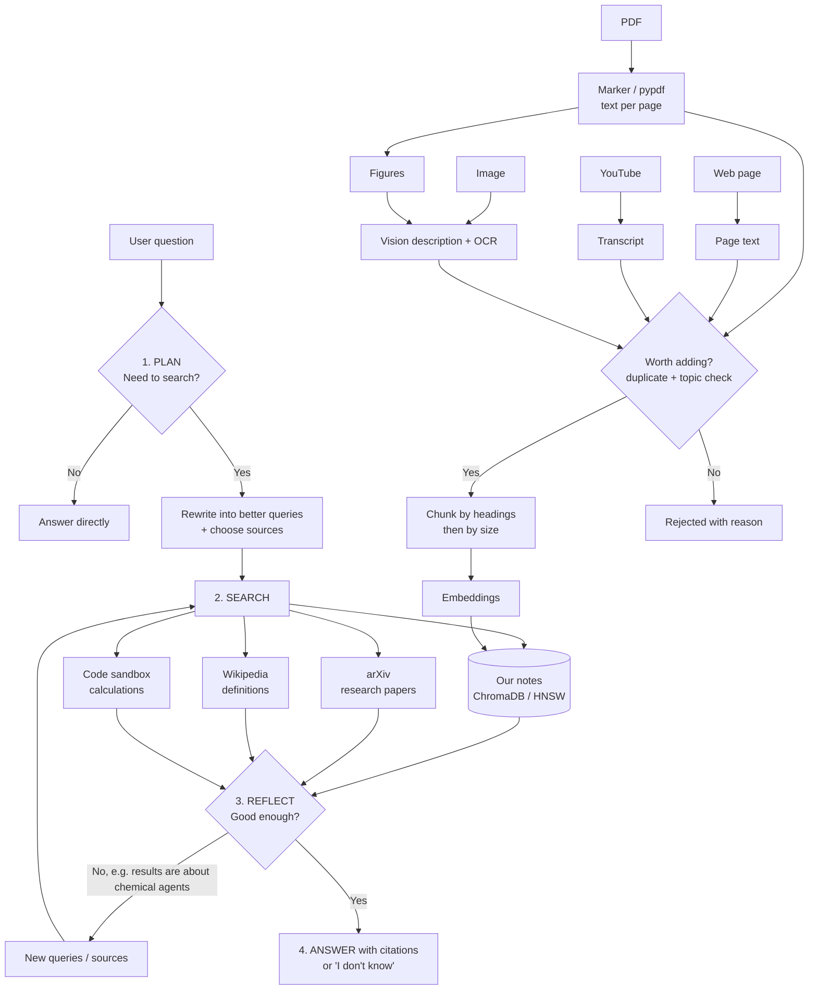

# 🤖 Agentic RAG Research Assistant

A research assistant **about Agentic RAG**: ask it what RAG is, how agentic RAG differs from
plain RAG, what Self-RAG, CRAG or ReAct do, how vector databases and HNSW work, and so on.
Every answer is built from real sources (our own documents, arXiv papers, Wikipedia) and
cites them as `[1] [2]`. If the sources don't have the answer, it says *"I don't know"*.

The system is itself **agentic RAG**: instead of always searching the same way, the agent
decides whether to search, what to search for, where to search, and whether to search again.

**Team**

| Person | Role |
|---|---|
| Huzaifa | Platform: agent, vector database, UI, evaluation |
| Michael | PDFs: research papers → `data/pdfs/` |
| Fatema | Web articles → `data/urls.txt`, YouTube videos → `data/youtube.txt` |
| Dimitri | Images: diagrams and screenshots → `data/images/` |
| Jeniffer | OpenAI API key (sent privately, goes into `.env`); used only for the evaluation judge and image descriptions |

---

## Quick start

```bash
pip install -r requirements.txt
pip install -r requirements-marker.txt   # optional, needs Python 3.10-3.12
cp .env.example .env                     # Windows: copy .env.example .env  - then paste the key
python self_test.py                      # checks everything works without the key
python download_papers.py                # downloads 15 core papers from arXiv into data/pdfs/
python load_team_data.py                 # loads everything in data/ into the database
streamlit run app.py                     # opens the UI in your browser
```

| What I want | Command |
|---|---|
| Check everything works (no key needed) | `python self_test.py` |
| Download the core papers | `python download_papers.py` |
| Load the team's data | `python load_team_data.py` (add `--reset` to start from empty) |
| Add single items | `python ingest.py paper.pdf diagram.png https://some-article.com https://youtu.be/ID` |
| Find the best chunk size | `python chunk_experiment.py` |
| Start the app | `streamlit run app.py` (or `python -m streamlit run app.py`) |
| Get results for the slides | `python evaluate.py --styles all` and `python evaluate.py --modes all` |
| Start the database fresh | delete the `chroma_db` folder, then `python load_team_data.py` |

---

## The data (what the knowledge base contains)

| Type | Where | What is in it | How it becomes text |
|---|---|---|---|
| **PDF** research papers | `data/pdfs/` | RAG (Lewis 2020), RAG survey, DPR, Agentic RAG survey, Self-RAG, CRAG, Adaptive-RAG, FLARE, ReAct, Toolformer, CoT, ToT, HyDE, HNSW, RAGAS (see `download_papers.py`) | Marker → Markdown with headings, **page numbers kept**; fallback: pypdf per page. Figures inside the PDF are described by GPT-4o-mini |
| **Web** articles | `data/urls.txt` | Wikipedia (RAG, vector DB, HNSW, embeddings, prompt engineering, LLMs), Weaviate, Hugging Face, Lilian Weng, Anthropic | Visible page text (WebBaseLoader) |
| **Video** | `data/youtube.txt` | IBM Technology videos on Agentic RAG | Caption transcript with `[mm:ss]` timestamps |
| **Images** | `data/images/` | Diagrams of the naive RAG pipeline and the agentic loop (add more: screenshots of figures, slides) | GPT-4o-mini writes a description (+ OCR text if Tesseract is installed). Or a `.txt` per image: line 1 = name, rest = description |
| Saved texts | `data/texts/` | Articles from sites that block automatic loading | Line 1 = title/URL, rest = text |

At question time the agent can also search **arXiv** (any RAG/agent paper, live) and
**Wikipedia** (definitions), and use a **code sandbox** for calculations (cosine similarity,
token/cost estimates).

**Embedding techniques for different data types.** We do not embed audio, video or pixels
directly. Every type is converted to text first (transcript, OCR, image description,
Markdown) and then embedded with the same text model. This keeps one vector space, so a
question can match a paper, a video and a diagram at the same time. The alternative would
be multimodal embeddings (e.g. CLIP for images), which need a separate index per modality.

---

## Architecture



## Files: what each one does

| File | Job |
|---|---|
| `config.py` | All settings (models, chunk size, k, HNSW settings, max search rounds) |
| `agent.py` | The agent loop: plan → search → reflect → answer. `ask()` and `ask_base_llm()` |
| `tools.py` | The 4 sources: notes, arXiv, Wikipedia, code sandbox |
| `prompts.py` | Every prompt (router, reflection, 4 answer styles, image description) |
| `vector_store.py` | ChromaDB, 3 search modes, duplicate check |
| `ingest.py` | PDF (Marker/pypdf), web, YouTube, image loading, worth-adding check, chunking |
| `app.py` | Streamlit UI: chat, settings, upload, before/after view |
| `load_team_data.py` | Loads everyone's data from `data/` in one go |
| `download_papers.py` | Downloads the core papers from arXiv |
| `chunk_experiment.py` | Compares chunk sizes on our data |
| `evaluate.py` | Plain LLM vs agentic RAG: accuracy, hallucination, refusal, faithfulness, time |
| `self_test.py` | Checks everything works without an API key |
| `tests/evaluation_cases.json` | The test questions with reference answers |

---

## How this covers the assignment

| Requirement | Where |
|---|---|
| 3+ document types | PDFs, web, YouTube, images (`ingest.py`) |
| LangChain loaders | `PyPDFLoader`, `WebBaseLoader`, `MarkdownHeaderTextSplitter` + `RecursiveCharacterTextSplitter` |
| Experiment with chunk size/overlap, find the optimum | `chunk_experiment.py` → `evaluation_results/chunk_experiment.csv` |
| Embeddings (OpenAI or all-MiniLM-L6-v2) | Both, `EMBEDDING_PROVIDER` in `.env` |
| ChromaDB with metadata (source, page, …) | source, page, section, type, url, file_hash, chunk |
| Similarity search with configurable k | `similarity` mode + k slider |
| Semantic search | `threshold` (relevance cut-off) and `mmr` (relevant + diverse) |
| Retrieval chain: query UI → retrieve → format → cited answer | `app.py` → `agent.ask()` |
| Zero-shot, few-shot, chain of thought, tree of thoughts | `prompts.py`, chosen in the sidebar |
| Citations + "don't know" fallback | `BASE_RULES` in `prompts.py` + `DONT_KNOW` in `agent.py` |
| Test queries in and out of the knowledge base | `tests/evaluation_cases.json` (in_scope, unanswerable, out_of_scope) |
| RAG vs base LLM | Compare toggle in the UI, `evaluate.py` |
| Accuracy + hallucination reduction | `evaluate.py` → `evaluation_results/summary.csv` |
| Faithfulness, relevance, hallucination detection (bonus) | `evaluate.py` (LLM judge) |
| Response time | Shown under every answer; avg/median in `summary.csv` |
| Architecture diagram | Above |
| Well-documented scripts | Every file starts with an explanation |

---

## Design decisions (the "why")

**Why agentic RAG?** Plain RAG searches every time, even for "hi", and searches with the
user's exact words, which are often vague. Our agent:
1. **Decides whether to retrieve.** Greetings and off-topic questions skip search (faster, cheaper).
2. **Rewrites the query.** "How does the AI check its own answers" → "Self-RAG reflection tokens".
3. **Chooses where to search.** Named paper → arXiv; definition → Wikipedia; maths → code; default → our notes.
4. **Searches again if needed.** "Agent" is ambiguous: if results are about chemical or travel
   agents, it searches again with "LLM agent …".

The LLM returns its decisions as **structured output** (Pydantic models `Plan` and
`Reflection`), so the code can read them reliably instead of parsing free text. This is the
same idea as Adaptive-RAG (route by question), Self-RAG / CRAG (judge the retrieved results)
and ReAct (reason, act with a tool, observe), which are all in our knowledge base.

**Why HNSW (not IVF-PQ)?** Users can add documents at any time. HNSW is a graph index that
accepts new vectors immediately with no retraining. IVF-PQ needs training on the data
and compresses vectors (less accurate), which makes sense for billions of vectors but not for us.
Chroma uses HNSW; we set cosine distance, `M=16`, `ef_construction=200`, `ef_search=100`.

**Why Marker for PDFs?** Research papers have headings, tables, equations and figures.
Marker converts them to clean Markdown (keeping structure), keeps page numbers and extracts
images, which we describe with a vision model. We then chunk **by Markdown headings first**,
so each chunk remembers its section title, and only cut long sections further by size.

**Chunking experiment.** *(Fill in after running `python chunk_experiment.py`.)*
We tested sizes 300–2000 with ~15% overlap. Small chunks are precise but lose context;
big chunks keep context but bring noise and cost more tokens. Chosen: `CHUNK_SIZE=____`,
`CHUNK_OVERLAP=____` because ____.

**Why check before adding a document?** Duplicate chunks waste space and make search return
the same text many times. We check: (1) exact file hash, (2) near-identical opening text
(similarity ≥ 0.92), (3) an LLM check that the document is about Agentic RAG / LLM systems.

**Search modes**
- `similarity`: top-k nearest vectors by cosine similarity. Simple and fast.
- `threshold`: semantic search that only keeps chunks above a relevance score (0.3), so weak
  matches are dropped and the agent can say "I don't know".
- `mmr` (Maximal Marginal Relevance): fetches 4×k candidates, then picks ones that are
  relevant **and** different from each other, so you don't get 4 copies of the same point.

**Prompt engineering** (choose in the sidebar): Zero-shot, Few-shot (two worked examples,
one of them a correct "I don't know"), Chain of Thought (4 explicit steps, then "Final
answer:"), Tree of Thoughts (2-3 branches, each rated by source support, best one chosen).
All require `[n]` citations and say *"I don't know based on the available sources"* when
the sources don't contain the answer.

**Context engineering** (what the LLM gets to see): sources are numbered and labelled with
file, page and section; duplicates are removed; at most 10 sources are sent; results from
a "search again" round are put **first**, so the improved results are never cut off.

**Why Agentic RAG as the topic scope?** The router and the worth-adding check keep the
assistant focused: off-topic questions (sport, cooking) are declined, and off-topic
uploads are rejected with a reason.

---

## Evaluation

```bash
python evaluate.py                      # quick: Zero-shot + similarity
python evaluate.py --styles all         # which prompt style works best?
python evaluate.py --modes all          # which search mode works best?
```

Each question in `tests/evaluation_cases.json` has a category:
- `in_scope`: answerable, with a reference answer → measures **accuracy**
- `unanswerable`: on-topic but invented (a fake paper, a false premise) → a plain LLM tends to
  make something up; this measures **hallucination reduction**
- `out_of_scope`: not about Agentic RAG → the assistant should decline

`evaluation_results/summary.csv` has one row per system (plain LLM, and RAG per style/mode):
accuracy, hallucination rate, refusal rate, false refusals, relevance (1-5), faithfulness,
average/median response time. `results.csv` has every single answer for the
success/failure analysis. The judge is an LLM, so check a sample by hand.

Add 5-10 questions about details that are only in *your* documents (e.g. a number from a
table in one paper) for the strongest before/after result.

---

## Testing the combined system (before the presentation)

Start the app and check the sidebar chunk count is above 0. Then:

| Test | Ask something like | Pass if |
|---|---|---|
| PDFs | "What are reflection tokens in Self-RAG?" | A source shows `self_rag_2023.pdf, page …` |
| Web | "What is a vector database?" | A source shows a Wikipedia URL |
| Video | "What does IBM say agentic RAG adds to RAG?" | A source starts with `YouTube:` |
| Images | "Describe the agentic RAG loop diagram" | A source starts with `Image:` |
| No search needed | `hi` | Trace says it decided no search is needed |
| Search again | "What are agents and how do they retrieve?" | Trace may say "Searching again" (it depends on what the first search finds) |
| arXiv | "What is the FLARE method?" | A source starts with `arXiv:` |
| Code | "Cosine similarity of [1,2,3] and [2,4,5]?" | Answer ≈ 0.996, source is the code sandbox |
| Outside the topic | "Who won the 2018 World Cup?" | It declines |
| Hallucination trap | "What did the HyperLoop-RAG paper report on TQ-Bench?" | RAG says it doesn't know; plain LLM may invent |
| Duplicate check | Upload a PDF that is already loaded | "Not added" with a reason |
| Before/after | Turn on Compare and ask any question | Plain LLM has no sources; RAG has citations |

## If something goes wrong

| Problem | Fix |
|---|---|
| "No OPENAI_API_KEY found" | `.env` is missing or saved as `.env.txt` (check with `dir`) |
| `streamlit` not recognized | `python -m streamlit run app.py` |
| A URL shows ERROR when loading | Save the article text into `data/texts/` instead |
| A YouTube video shows ERROR | The video has no captions; pick another |
| Answers ignore the team's data | Check the chunk count, then try `mmr` and a higher k |
| Everything says "I don't know" | Switch search mode from `threshold` to `similarity` |
| arXiv or Wikipedia searches fail | Internet issue; the agent skips them and uses your notes |
| OpenAI "rate limit" / "quota" | The key ran out of credit; ask Jeniffer to top up |
| Changed chunk size but nothing changed | Delete `chroma_db`, run `load_team_data.py` again |
| Switched `EMBEDDING_PROVIDER` | Each provider has its own collection; run `load_team_data.py` again |

## Pushing to GitHub

```bash
git status --short          # .env and chroma_db/ must NOT appear
git add .
git commit -m "Agentic RAG: agent loop, 4 sources, 4 media types, evaluation"
git push
```
`.gitignore` already excludes `.env`, `chroma_db/`, `extracted_images/`, `__pycache__/` and
`.venv/`. Only commit PDFs you are allowed to share (arXiv papers are fine to link; you can
also leave `data/pdfs/` out and let people run `download_papers.py`).

## Notes and limitations
- The code sandbox only allows maths-type imports (math, statistics, …), blocks file access
  and `eval`, and runs in a separate process with a 10-second limit. It is a reasonable
  safety layer for a demo, not a full security sandbox.
- arXiv and Wikipedia are free public APIs; no key needed. arXiv asks for a 3-second pause
  between requests, so arXiv searches take a few seconds.
- Answers (planning, reflection, writing) run locally on Ollama (`CHAT_MODEL`, default `qwen2.5:3b`), so they are free.
- OpenAI is used only for the evaluation judge (`JUDGE_MODEL`), image descriptions (`VISION_MODEL`) and, if you set `EMBEDDING_PROVIDER=openai`, embeddings. It costs money (small with gpt-4o-mini); each image description is one API call.
- If Marker isn't installed, PDFs fall back to pypdf (plain text per page; figures still extracted when possible).
- Report only numbers you actually measured.
